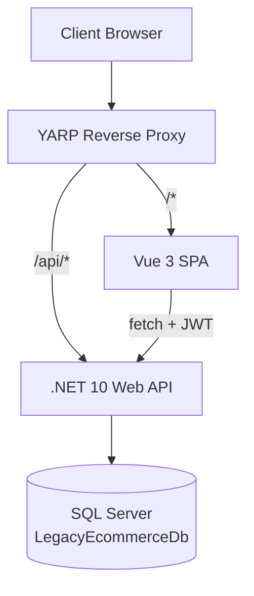

# RAW.FORM — eCommerce Migration

> Modernization of a legacy ASP.NET MVC 5 eCommerce application to a decoupled **Vue 3 + .NET 10 Web API** stack using the **Strangler Fig Pattern**.

## Overview

This repository contains the complete modernized eCommerce application — a full-stack monorepo with a stateless .NET 10 backend, a Vue 3 SPA frontend, and a YARP reverse proxy. The legacy ASP.NET MVC 5 application has been successfully modernized into a Vue 3 + .NET 10 architecture using the Strangler Fig migration pattern while preserving feature parity; all traffic now routes to the modern stack.

The migration was executed across 10 phases (125 tasks) using the Strangler Fig pattern: vertical slice by vertical slice, running old and new systems side-by-side until the legacy app could be safely removed.

## Features

- **Authentication** — JWT Bearer (HS256), native login/register, token persistence, expiry handling
- **Product Catalog** — Browse, search, filter, sort, paginate, hierarchical category tree
- **Product Detail** — Image gallery with thumbnails, variant selector, stock display, price adjustment
- **Shopping Cart** — Add, remove, update quantity, persistent per-customer cart, auth-gated
- **Checkout** — 5-step wizard: Address → Shipping Method → Payment → Review → Confirm
- **Shipping Options** — Standard (₹99) and Express (₹199) with GST (18%) tax calculation
- **Mock Payment** — Card form with client-side validation (16-digit card, MM/YY expiry, 3-4 digit CVV)
- **Order Management** — Order history, order detail, order confirmation, idempotent order placement
- **Account** — Profile view, account dashboard, user menu with auth-aware footer links
- **Currency** — Indian Rupees (₹) via `Intl.NumberFormat('en-IN')` shared formatter

## Architecture



### Layered Backend

```
src/backend/
├── Ecommerce.Api/          ← Controllers, DI, YARP, middleware
├── Ecommerce.Api.Core/     ← Models, DTOs, Interfaces, Security
├── Ecommerce.Api.Services/ ← Business logic implementations
└── Ecommerce.Api.Data/     ← ADO.NET repositories, DatabaseHelper
```

### Technology Stack

| Layer | Technology | Version |
|-------|-----------|---------|
| Backend | .NET 10 Web API | SDK 10.0.302 |
| Frontend | Vue.js 3 (Composition API) | 3.5.x |
| Build (FE) | Vite | 8.x |
| State (FE) | Pinia | 4.x |
| Router (FE) | Vue Router | 5.x |
| Gateway | YARP Reverse Proxy | 2.3.0 |
| Database | SQL Server (LocalDB) | — |
| Data Access | ADO.NET (Microsoft.Data.SqlClient) | 5.2.2 |
| Auth | JWT Bearer (HS256) | — |
| Testing (BE) | xUnit + Moq | — |
| Testing (FE) | Vitest + Vue Test Utils | — |
| Testing (E2E) | Playwright | — |

## Folder Structure

```
ecommerce-migration/
├── .github/              ← CI/CD workflows, PR templates, dependabot
├── config/               ← Shared configs (editorconfig, stylecop)
├── docs/                 ← All project documentation
│   ├── api/              ← Endpoint catalog, OpenAPI spec
│   ├── architecture/     ← Architecture, data flow, auth, deployment
│   ├── decisions/        ← Architecture Decision Records (ADRs)
│   ├── migration/        ← Task lists, roadmaps, reports, progress
│   ├── reference/        ← Legacy notes, prompt library
│   └── runbooks/         ← Setup, seeding, incident, rollback guides
├── src/
│   ├── backend/          ← .NET 10 solution (API, Core, Services, Data, Tests)
│   ├── frontend/         ← Vue 3 SPA (Vite + Pinia + Vue Router)
│   ├── gateway/          ← YARP gateway (placeholder)
│   ├── migration/        ← DB migration tool (placeholder)
│   └── shared/           ← Shared contracts (placeholder)
├── tests/                ← E2E (Playwright), integration, load, contract tests
├── Directory.Build.props ← Shared MSBuild properties
├── Directory.Packages.props ← Central package version management
├── Ecommerce.sln         ← .NET solution file
├── global.json           ← .NET SDK version
└── Makefile             ← Common commands
```

## Prerequisites

| Tool | Version | Purpose |
|------|---------|---------|
| [.NET SDK](https://dotnet.microsoft.com/download) | 10.0.302+ | Backend API, tests |
| [Node.js](https://nodejs.org/) | 22+ | Frontend SPA, E2E tests |
| [npm](https://www.npmjs.com/) | 10+ | Package management |
| [SQL Server ](https://learn.microsoft.com/sql/database-engine/configure-windows/sql-server-express-localdb) | — | Database |
| [Git](https://git-scm.com/) | 2.x | Version control |

## Local Setup

### Backend

```bash
cd src/backend

# Restore packages
dotnet restore Ecommerce.sln

# Run the API 
dotnet run --project Ecommerce.Api/Ecommerce.Api.csproj
```

### Frontend

```bash
cd src/frontend/spa

# Install dependencies
npm install

# Start dev server 
npm run dev
```

### Database

The application uses SQL Server  with a `LegacyEcommerceDb` database.

```bash
# Setup database (creates + seeds)
./scripts/setup.sh          # Linux/macOS
.\scripts\setup.ps1          # Windows
```

Connection string (in `src/backend/Ecommerce.Api/appsettings.json`):
```
Server=(localdb)\MSSQLLocalDB;Database=LegacyEcommerceDb;Trusted_Connection=True;TrustServerCertificate=True;
```

See [Local Setup Runbook](docs/runbooks/local-setup.md) for detailed instructions.

## Running the Application

```bash
# Terminal 1: Backend API 
cd src/backend
dotnet run --project Ecommerce.Api/Ecommerce.Api.csproj

# Terminal 2: Frontend SPA 
cd src/frontend/spa
npm run dev
```

After starting both services, open the application in your browser.
> YARP reverse proxy runs as part of the API process and routes SPA paths.

## Running Tests

### Backend Tests (xUnit)

```bash
cd src/backend

# Run all tests
dotnet test Ecommerce.sln

# Or run specific test projects
dotnet test Ecommerce.Api.Tests/Ecommerce.Api.Tests.csproj
dotnet test Ecommerce.Api.Core.Tests/Ecommerce.Api.Core.Tests.csproj
```

### Frontend Tests (Vitest)

```bash
cd src/frontend/spa

# Run unit tests
npx vitest run

# Run in watch mode
npx vitest
```

### E2E Tests (Playwright)

```bash
cd tests/e2e
npm install
npx playwright test
```

## Build Commands

### Backend

```bash
cd src/backend

# Build entire solution
dotnet build Ecommerce.sln

# Build API only
dotnet build Ecommerce.Api/Ecommerce.Api.csproj
```

### Frontend

```bash
cd src/frontend/spa

# Production build (includes type check via vue-tsc)
npm run build

# Preview production build
npm run preview
```

### Makefile Shortcuts

```bash
make build     # Build backend + frontend
make test      # Run all tests
make lint      # Lint everything
make docker-up # Start all services via Docker
```

## Architecture Overview

The application follows a **layered architecture** with clear separation of concerns:

- **Controllers** (`Ecommerce.Api/Controllers/`) — HTTP endpoints, model validation, JWT claim extraction
- **Services** (`Ecommerce.Api.Services/`) — Business logic, orchestration, validation
- **Repositories** (`Ecommerce.Api.Data/`) — ADO.NET data access via `DatabaseHelper`
- **Models/DTOs** (`Ecommerce.Api.Core/`) — Domain entities, data transfer objects, interfaces
- **Security** (`Ecommerce.Api.Core/Security/`) — JWT token generation and validation

The SPA uses **Pinia stores** for state management, **Vue Router** for navigation, and a shared **`fetch` wrapper** (`api/client.ts`) that handles JWT attachment and error propagation.

## Migration Strategy (Strangler Fig)

The migration followed the **Strangler Fig Pattern**:

1. **Phase 1** — Infrastructure (YARP, solution, DB connectivity)
2. **Phase 2** — Authentication (JWT, login/register)
3. **Phase 3** — Product Catalog (browse, search, detail)
4. **Phase 4** — Category Navigation (tree, filter)
5. **Phase 5** — Shopping Cart (add, remove, update)
6. **Phase 6** — Checkout (address, shipping, payment, order)
7. **Phase 7** — Order History (list, detail)
8. **Phase 8** — Home / Landing (featured products)
9. **Phase 9** — Full E2E regression
10. **Phase 10** — Decommission legacy (all traffic → SPA)

See [Migration Documentation](docs/migration/README.md) for the complete task list, roadmap, and progress.

## Documentation

All documentation lives under [`docs/`](docs/). See the [Documentation Index](docs/README.md) for a complete map.

### Key Documents

| Category | Document | Description |
|----------|----------|-------------|
| Architecture | [Architecture Overview](docs/architecture/README.md) | Topology, tech stack, request lifecycle |
| Architecture | [Target State](docs/architecture/target-state.md) | Modern architecture design |
| Architecture | [Auth Strategy](docs/architecture/auth-strategy.md) | JWT authentication flow |
| Architecture | [Data Flow](docs/architecture/data-flow.md) | Request lifecycle diagrams |
| Architecture | [Deployment Model](docs/architecture/deployment-model.md) | Containers, CI/CD, infra |
| Decisions | [ADR Index](docs/decisions/README.md) | Architecture decision records |
| Migration | [Master Task List](docs/migration/master-task-list.md) | T-001 → T-125 task breakdown |
| Migration | [Progress](docs/migration/progress.md) | Final status and deviations |
| Migration | [Feature Parity Report](docs/migration/feature-parity-report.md) | Legacy vs modern audit |
| API | [Endpoint Catalog](docs/api/endpoint-catalog.md) | All REST endpoints |
| API | [OpenAPI Spec](docs/api/openapi.yaml) | Machine-readable spec |
| Runbooks | [Local Setup](docs/runbooks/local-setup.md) | Environment setup guide |
| Runbooks | [Incident Response](docs/runbooks/incident-response.md) | Production incident guide |
| Reference | [Legacy Codebase Notes](docs/reference/legacy-codebase-notes.md) | Migration mappings, gotchas |


## License

<!-- Add license information here -->

See [LICENSE](LICENSE).
