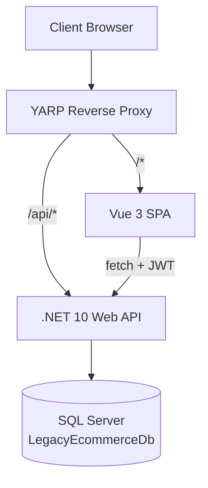
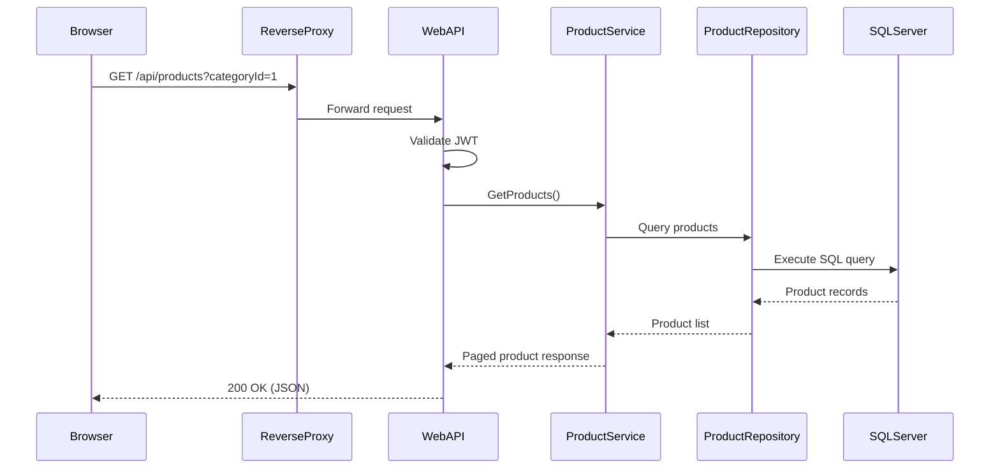

# Architecture

This directory contains the architecture documentation for the eCommerce migration project.

## Documents

| Document | Description |
|----------|-------------|
| [Architecture Migration Plan](architecture-migration-plan.md) | Complete analysis of legacy architecture, target architecture, and migration strategy |
| [Monorepo Design](monorepo-design.md) | Repository structure, folder purposes, and project organization |
| [Current State](current-state.md) | Legacy ASP.NET MVC 5 application architecture |
| [Target State](target-state.md) | Modern Vue 3 + .NET 10 Web API architecture |
| [Data Flow](data-flow.md) | Request lifecycle from browser to database |
| [Auth Strategy](auth-strategy.md) | JWT authentication and authorization |
| [Deployment Model](deployment-model.md) | Container, infrastructure, and deployment topology |

## Architecture Overview



### Technology Stack

| Layer | Technology | Version |
|-------|-----------|---------|
| Backend | .NET 10 Web API | SDK 10.0.302 |
| Frontend | Vue.js 3 (Composition API) | 3.5.x |
| Build (FE) | Vite | 8.x |
| State (FE) | Pinia | 4.x |
| Router (FE) | Vue Router | 5.x |
| Gateway | YARP Reverse Proxy | 2.3.0 |
| Database | SQL Server (LocalDB) | — |
| Data Access | ADO.NET (Microsoft.Data.SqlClient 5.2.2) | — |
| Auth | JWT Bearer (HS256) | — |
| Testing (BE) | xUnit + Moq | — |
| Testing (FE) | Vitest + Vue Test Utils | — |
| Testing (E2E) | Playwright | — |

### Layered Architecture

```
src/backend/
├── Ecommerce.Api/              ← Controllers, DI, YARP config
│   ├── Controllers/            ← HTTP endpoints
│   └── Program.cs              ← App composition root
├── Ecommerce.Api.Core/         ← Domain models, DTOs, interfaces
│   ├── DTOs/                   ← Data transfer objects
│   ├── Interfaces/             ← Repository & service contracts
│   ├── Models/                 ← Domain entities
│   └── Security/               ← JWT token service
├── Ecommerce.Api.Data/         ← ADO.NET repositories
│   ├── Repositories/           ← SQL implementations
│   └── DatabaseHelper.cs       ← Connection/transaction wrapper
└── Ecommerce.Api.Services/     ← Business logic
    ├── Interfaces/             ← Service contracts
    └── Implementations/        ← Service implementations
```

### Request Lifecycle



## Related

- [Architecture Decision Records](../decisions/README.md)
- [Migration Documentation](../migration/progress.md)
- [API Reference](../api/endpoint-catalog.md)
