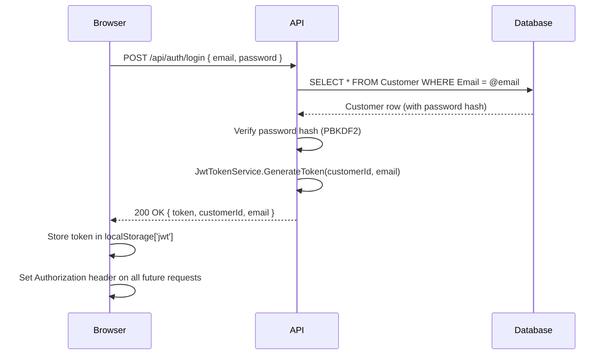
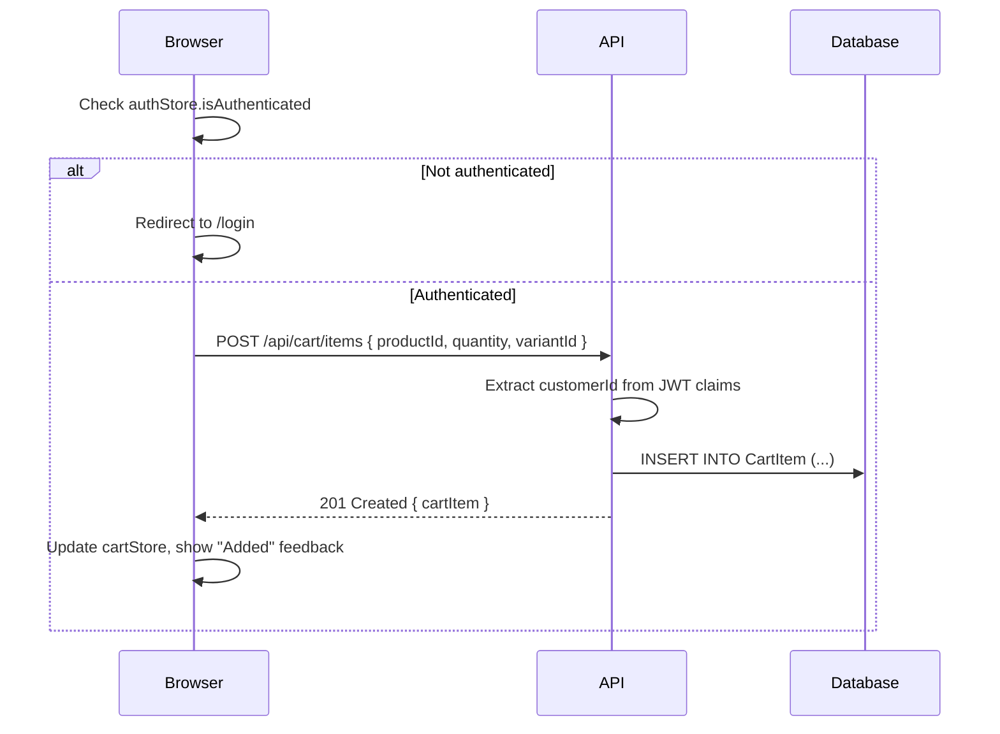

# Data Flow

## Overview

This document describes how data flows through the system for each major operation.

## Product Browsing

```mermaid
flowchart LR
    Browser -->|GET /products?categoryId=1&page=1| YARP
    YARP -->|SPA route| Vite[Vue SPA :5002]
    Vite -->|GET /api/products?categoryId=1| API[.NET API :5001]
    API -->|ProductService.GetProducts| Svc
    Svc -->|GetProductsByCategoryTree| Repo[ProductRepository]
    Repo -->|SELECT * FROM Product WHERE CategoryId IN ...| DB[(SQL Server)]
    DB -->|DataTable| Repo
    Repo -->|IEnumerable<Product>| Svc
    Svc -->|PagedResult<ProductListResponseDto>| API
    API -->|200 OK JSON| Vite
    Vite -->|Render product grid| Browser
```



### Category Tree Filtering

When a user selects a parent category, the `ProductService` resolves all descendant category IDs in memory (via `ICategoryRepository.GetAll()`) and queries products matching any of those IDs:

```
Selected: Electronics (ID=1)
  Children: Phones (ID=6), Laptops (ID=7)
Query: SELECT * FROM Product WHERE CategoryId IN (1, 6, 7)
```

`# ponytail: in-memory tree walk; if catalog grows large, move to recursive SQL CTE`

## Authentication



## Add to Cart



## Checkout Flow

```mermaid
flowchart TD
    S1[Step 1: Select Address] --> S2[Step 2: Select Shipping Method]
    S2 --> S3[Step 3: Enter Payment Details]
    S3 --> S4[Step 4: Review Order]
    S4 --> S5[Step 5: Place Order]

    S5 -->|POST /api/checkout/orders\nwith Idempotency-Key header| API[.NET API]
    API -->|CheckoutService.PlaceOrder| Svc
    Svc -->|Check idempotency key| DB[(SQL Server)]
    alt Existing order
        DB -->|Return existing| Svc
    else New order
        Svc -->|Deduct stock| DB
        Svc -->|Create billing address| DB
        Svc -->|Calculate totals (subtotal + shipping + GST 18%)| Svc
        Svc -->|Create Order + OrderItems| DB
        Svc -->|Clear cart| DB
        Svc -->|Commit transaction| DB
    end
    Svc -->|OrderConfirmationDto| API
    API -->|201 Created| Browser
    Browser -->|Redirect to /checkout/confirmation/{orderId}| Done
```

## Order Totals Calculation

```
SubTotal     = Σ(unitPrice × quantity) for all cart items
Shipping     = Standard ₹99 | Express ₹199 (user-selected)
TaxTotal     = (SubTotal + Shipping) × 0.18 (GST 18%)
GrandTotal   = SubTotal + Shipping + TaxTotal
```

## Related

- [Target State](target-state.md)
- [Auth Strategy](auth-strategy.md)
- [API Reference](../api/endpoint-catalog.md)