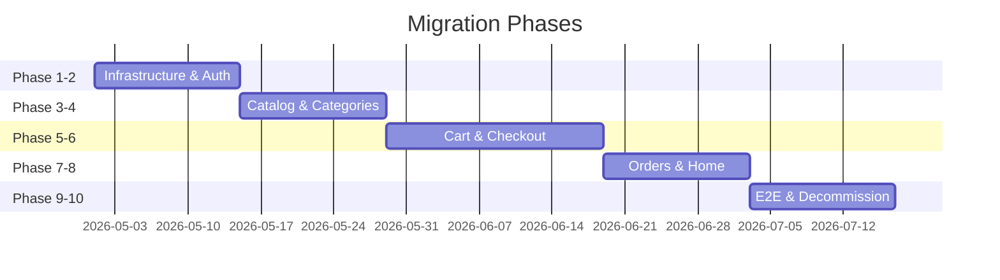

# Migration

This directory contains all documentation related to the migration from the legacy ASP.NET MVC 5 application to the modern Vue 3 + .NET 10 Web API stack.

## Documents

### Planning

| Document | Description |
|----------|-------------|
| [Master Task List](master-task-list.md) | Complete task breakdown (T-001 → T-125) with acceptance criteria |
| [Orchestration](orchestration.md) | Execution strategy, timeline, stakeholder roles |
| [Implementation Roadmap](implementation-roadmap.md) | Phase-by-phase checklist with file names and commands |

### Reports

| Document | Description |
|----------|-------------|
| [Progress](progress.md) | Migration progress tracking, final status, deviations |
| [Feature Parity Report](feature-parity-report.md) | Audit of legacy features vs modern implementation |
| [Functional Verification Report](functional-verification-report.md) | End-to-end verification of all user flows |
| [Cart Verification Report](cart-verification-report.md) | Cart and user menu audit findings and fixes |
| [Blocker — T-020](blocker-t020.md) | JWT bridge blocker report and resolution |

## Migration Strategy

The migration follows the **Strangler Fig Pattern** — vertical slice by vertical slice, running old and new systems side-by-side until the legacy app is decommissioned.

## Final Status

| Component | Status |
|-----------|--------|
| All 10 phases (T-001–T-125) | ✅ Complete |
| Backend tests (29) | ✅ All pass |
| Frontend tests (10) | ✅ All pass |
| E2E tests (6) | ✅ All pass |
| SPA build | ✅ Success |
| Solution build | ✅ Success (0 errors) |

See [Progress](progress.md) for full details.

## Related

- [Architecture](../architecture/README.md)
- [Decisions (ADRs)](../decisions/README.md)
- [Reference](../reference/README.md)